# Dokumentasi Reproduksi Task 1 Digital Forensics
## USB Deleted File Recovery menggunakan FTK Imager dan TestDisk

Dokumentasi ini mereproduksi seluruh proses Task 1 yang telah dilakukan, mulai dari menyiapkan USB, membuat dan menghapus file, membuat forensic image, melakukan recovery, hingga memverifikasi integritas evidence menggunakan hash.

> **Peringatan penting:** bagian `diskpart` menggunakan `clean all`, yang akan menghapus seluruh isi disk yang dipilih. Jangan pernah menjalankan `clean all` sebelum memastikan disk yang dipilih benar-benar USB target.

---

# 0. Environment dan Identitas Eksperimen

## Perangkat

```text
USB Flash Drive : SanDisk Cruzer Switch
Nominal Size    : 16 GB
Usable Size     : ±14.6 GB
Partition Table : MBR
File System     : FAT32
Volume Label    : DF_GROUP3
```

## Tools

```text
FTK Imager
Product Version : 8.3.0.27
File Version    : 8.2.2.999

TestDisk
Version         : 7.2

PowerShell
Command         : Get-FileHash

DiskPart
Windows built-in utility
```

PhotoRec 7.2 tersedia dalam paket TestDisk, tetapi tidak digunakan dalam recovery akhir karena recovery berhasil menggunakan TestDisk `Undelete`.

### Perbedaan FTK Imager dan TestDisk

Kedua tool dipakai untuk tujuan yang berbeda:

| Tool | Fungsi utama dalam eksperimen ini |
|---|---|
| **FTK Imager** | Membuat **forensic image** dari USB secara sector-by-sector dan melakukan verifikasi hasil image. Fokusnya adalah **acquisition dan preservation**. |
| **TestDisk** | Membaca filesystem dari forensic image, menemukan file yang sudah dihapus, lalu menyalin file tersebut ke folder recovery. Fokusnya adalah **examination dan recovery**. |

Secara sederhana:

```text
FTK Imager
USB fisik → forensic image

TestDisk
forensic image → cari deleted file → recovery
```

FTK Imager digunakan agar analisis tidak dilakukan langsung pada USB asli. Setelah image selesai dibuat dan diverifikasi, TestDisk bekerja pada image tersebut untuk mencari file yang telah dihapus.

## Gambaran Tahapan Forensik yang Digunakan

Workflow pada eksperimen ini mengikuti tahapan umum digital forensics:

### 1. Preparation

**Preparation** adalah tahap menyiapkan lingkungan sebelum pemeriksaan dimulai.

Pada eksperimen ini meliputi:
- menyiapkan USB,
- membersihkan sisa partisi Ventoy,
- membuat satu partisi FAT32,
- menyiapkan folder kerja,
- menyiapkan FTK Imager dan TestDisk,
- mencatat versi tool,
- membuat kondisi awal USB yang diketahui dengan jelas.

Tujuannya agar eksperimen dimulai dari kondisi yang terkontrol dan mudah direproduksi.

### 2. Collection

**Collection** adalah tahap mengidentifikasi, mengambil, dan menjaga evidence.

Pada eksperimen ini meliputi:
- memasukkan `evidence_group3.jpg` ke USB,
- menghitung hash file sebelum dihapus,
- melakukan `Shift + Delete`,
- membuat forensic image menggunakan FTK Imager,
- memverifikasi image,
- menyimpan USB fisik dan melanjutkan analisis hanya pada forensic image.

Bagian terpenting pada tahap ini adalah **acquisition**.

**Acquisition** adalah proses mengambil salinan forensik dari media digital. Dalam eksperimen ini USB tidak sekadar di-copy file yang terlihat, tetapi seluruh media dibaca secara sector-by-sector dan disimpan menjadi forensic image. Dengan cara ini, area yang sudah tidak terlihat oleh File Explorer, termasuk ruang yang berpotensi masih menyimpan deleted file, ikut tersalin.

### 3. Examination

**Examination** adalah tahap memeriksa data yang sudah dikumpulkan untuk mencari artefak yang relevan.

Pada eksperimen ini TestDisk membuka forensic image, membaca partisi FAT32, lalu mencari directory entry milik `evidence_group3.jpg` yang sudah dihapus.

### 4. Analysis

**Analysis** adalah tahap menilai apakah hasil examination benar-benar menjawab tujuan investigasi.

Pada eksperimen ini dilakukan dengan:
- membandingkan SHA-256 file original dan file recovered,
- memeriksa apakah gambar recovered dapat dibuka,
- membandingkan SHA-256 forensic image sebelum dan sesudah examination.

Jika hash original dan recovered sama, file hasil recovery identik bit-for-bit dengan file awal.

### 5. Reporting

**Reporting** adalah tahap mendokumentasikan apa yang dilakukan dan apa yang ditemukan.

Isinya meliputi:
- identitas evidence,
- tool dan versinya,
- langkah kerja,
- screenshot,
- hash,
- hasil recovery,
- temuan,
- keterbatasan,
- kesimpulan.

Tujuannya agar orang lain dapat memahami dan mengulangi proses yang sama.

## Istilah Penting dalam Dokumentasi Forensik

### Evidence Inventory

**Evidence inventory** adalah daftar barang atau data yang dianggap sebagai evidence beserta identitasnya.

Contoh pada eksperimen ini:

```text
E-01 = SanDisk Cruzer Switch 16 GB sebagai physical evidence
E-02 = Group3_SanDisk16GB_20261005.001 sebagai forensic image
```

Biasanya inventory mencatat nama/model, ukuran, kondisi, nomor evidence, dan nama file image.

### Integrity Verification

**Integrity verification** adalah pengecekan bahwa evidence tidak berubah.

Caranya menggunakan nilai **hash**, misalnya SHA-256. File yang isinya sama akan menghasilkan hash yang sama. Karena itu hash forensic image dihitung sebelum dan sesudah examination.

```text
Hash sebelum analysis == Hash setelah analysis
→ evidence image tidak berubah
```

### Chain of Custody

**Chain of custody** adalah catatan siapa yang memegang atau menangani evidence, kapan evidence berpindah tangan, untuk tujuan apa, dan di mana evidence disimpan.

Contoh sederhana:

```text
05-Oct-2026 | E-01 | Dapunta | Dapunta | Acquisition | USB disimpan setelah imaging
05-Oct-2026 | E-02 | Dapunta | Dapunta | Examination | Folder 02_Acquisition
```

Tujuannya agar riwayat penanganan evidence jelas dan dapat dipertanggungjawabkan.

---

# 1. Siapkan Struktur Folder Investigasi

Buka PowerShell.

```powershell
$Root = "C:\Users\ASUS ZENBOOK\Documents\DapuntaXD\All About ITS\Semester 7\Forensik Digital\Tugas\DigitalForensics_Assignment1"
```

Buat folder:

```powershell
New-Item -ItemType Directory -Force "$Root\01_Original"
New-Item -ItemType Directory -Force "$Root\02_Acquisition"
New-Item -ItemType Directory -Force "$Root\03_Recovery"
New-Item -ItemType Directory -Force "$Root\04_Screenshots"
New-Item -ItemType Directory -Force "$Root\05_Hash"
```

Struktur:

```text
DigitalForensics_Assignment1
├── 01_Original
├── 02_Acquisition
├── 03_Recovery
├── 04_Screenshots
└── 05_Hash
```

Variabel tambahan:

```powershell
$OriginalFile = "$Root\01_Original\evidence_group3.jpg"
$RecoveredFile = "$Root\03_Recovery\evidence_group3.jpg"
$HashDir = "$Root\05_Hash"
```

---

# 2. Bersihkan USB Bekas Ventoy

Jalankan Command Prompt atau Windows Terminal sebagai Administrator.

```cmd
diskpart
```

Lihat disk:

```text
list disk
```

Contoh:

```text
Disk ###  Status         Size     Free     Dyn  Gpt
--------  -------------  -------  -------  ---  ---
Disk 0    Online          953 GB      0 B        *
Disk 1    Online           14 GB      0 B
```

Pada eksperimen:
- Disk 0 = internal disk
- Disk 1 = SanDisk USB

> Jangan mengasumsikan USB selalu Disk 1.

Pilih kandidat USB:

```text
select disk 1
```

Verifikasi:

```text
detail disk
```

Target:

```text
SanDisk Cruzer Switch USB Device
Type   : USB
Status : Online
...
Volume 4     D   Ventoy       exFAT  Removable     14 GB
Volume 5     E   VTOYEFI      FAT    Removable     32 MB
```

Jika model, tipe, dan ukuran tidak sesuai, jangan lanjut.

---

# 3. Zero-fill Seluruh USB

Setelah disk benar-benar terverifikasi:

```text
clean all
```

Tunggu sampai:

```text
DiskPart succeeded in cleaning the disk.
```

Perbedaan:

```text
clean
→ menghapus metadata partisi

clean all
→ menulis zero ke seluruh logical sector
```

Screenshot:

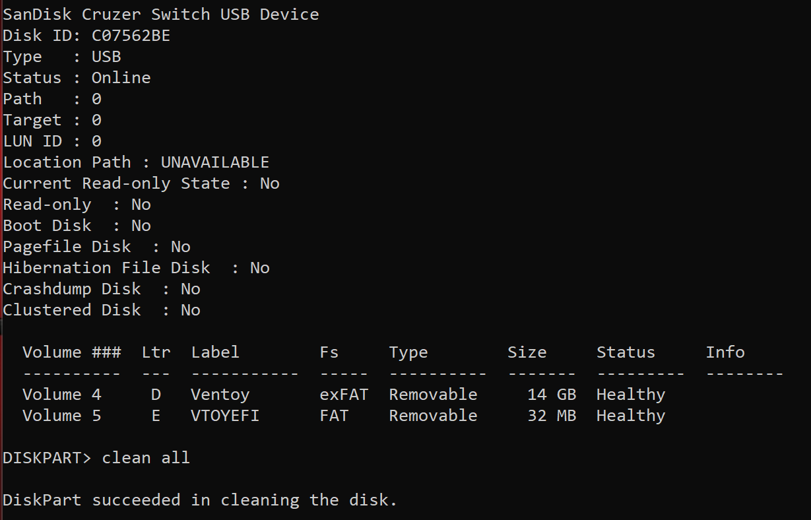

---

# 4. Buat Partisi Baru FAT32

Sebelum menjalankan command, ada dua istilah penting pada tahap ini.

### Apa itu MBR?

**MBR (Master Boot Record)** adalah salah satu format tabel partisi pada disk. Secara sederhana, MBR memberi tahu sistem operasi bagaimana ruang pada disk dibagi menjadi partisi.

Pada eksperimen ini dipilih MBR karena:
- sederhana untuk USB 16 GB,
- kompatibel luas dengan Windows dan tool forensik,
- tidak membutuhkan struktur GPT/EFI,
- sesuai dengan pilihan `Intel/PC partition` yang nanti digunakan di TestDisk.

Command:

```text
convert mbr
```

membuat USB menggunakan skema partisi MBR.

### Apa itu FAT32?

**FAT32** adalah filesystem, yaitu aturan yang digunakan sistem operasi untuk menyimpan dan mencatat file di dalam suatu partisi.

Secara sederhana:

```text
MBR
→ mengatur pembagian/partisi disk

FAT32
→ mengatur file dan folder di dalam partisi
```

FAT32 dipilih karena:
- cocok untuk flash drive 16 GB,
- didukung luas oleh Windows dan TestDisk,
- strukturnya relatif sederhana,
- cocok untuk latihan deleted-file recovery.

Saat file dihapus pada FAT32, data file tidak selalu langsung hilang dari sector penyimpanan. Entry file ditandai sebagai sudah tidak digunakan dan cluster-nya dianggap tersedia untuk dipakai lagi. Selama cluster tersebut belum tertimpa data baru, file masih mungkin direcover.

Masih di DiskPart:

```text
convert mbr
create partition primary
format fs=fat32 quick label=DF_GROUP3
assign
detail disk
list volume
```

Target:

```text
DF_GROUP3
FAT32
Removable
±14 GB
Healthy
```

Keluar:

```text
exit
```

Screenshot:

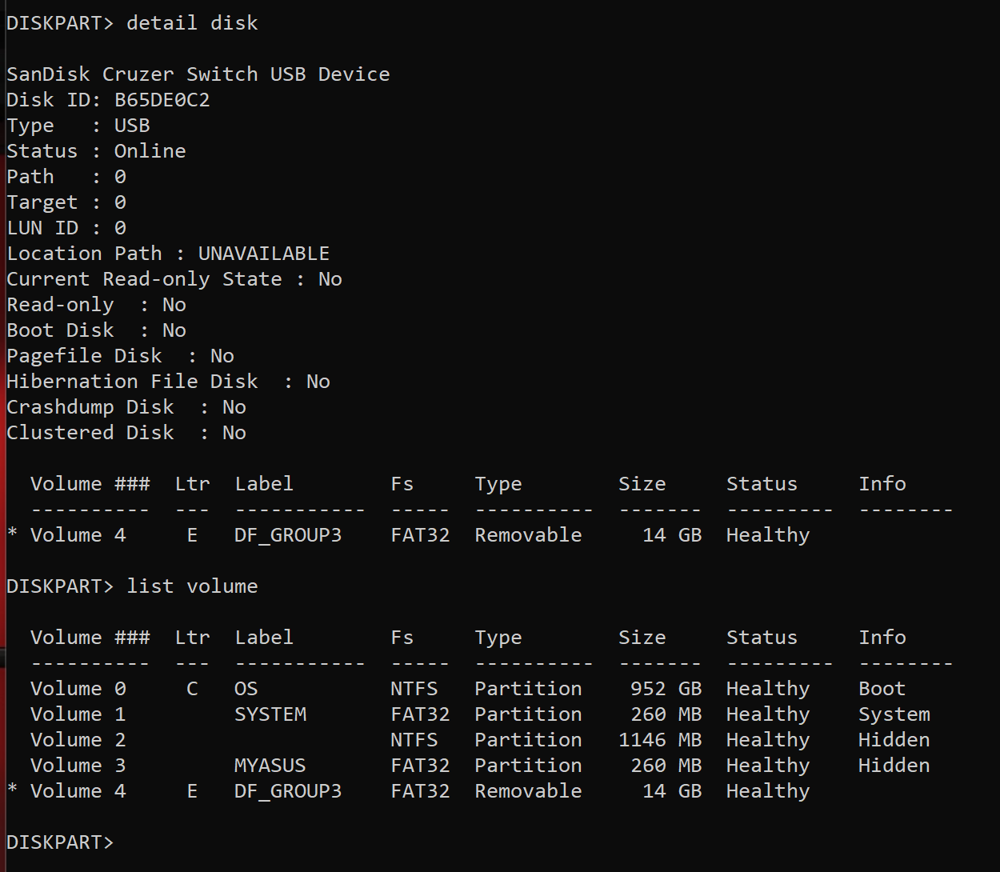
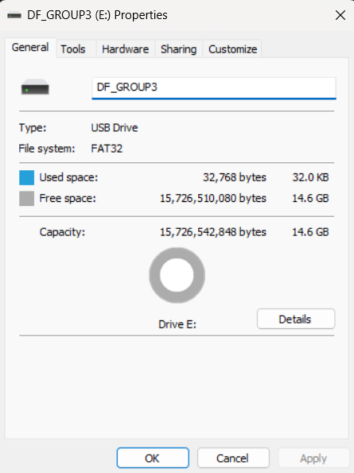

---

# 5. Verifikasi Properties USB

Buka:

```text
This PC
→ klik kanan DF_GROUP3
→ Properties
```

Pastikan:

```text
File system : FAT32
Capacity    : ±14.6 GB
Label       : DF_GROUP3
```

---

# 6. Siapkan File Target

Buat file:

```text
evidence_group3.jpg
```

Isi eksperimen:

```text
DIGITAL FORENSICS
GROUP 3
DELETED FILE RECOVERY TEST
05 OCTOBER 2026
```

Simpan ke:

```text
C:\Users\ASUS ZENBOOK\Documents\DapuntaXD\All About ITS\Semester 7\Forensik Digital\Tugas\DigitalForensics_Assignment1\01_Original\evidence_group3.jpg
```

---

# 7. Hitung SHA-256 Original

```powershell
Get-FileHash "$OriginalFile" -Algorithm SHA256
```

Nilai eksperimen:

```text
458A79BCB8303CB8A077D26699552D3E33434FEBCA0E4293E7F1547D68F4D591
```

Simpan:

```powershell
Get-FileHash "$OriginalFile" -Algorithm SHA256 |
    Format-List |
    Out-File "$HashDir\original_sha256.txt"
```

Screenshot:

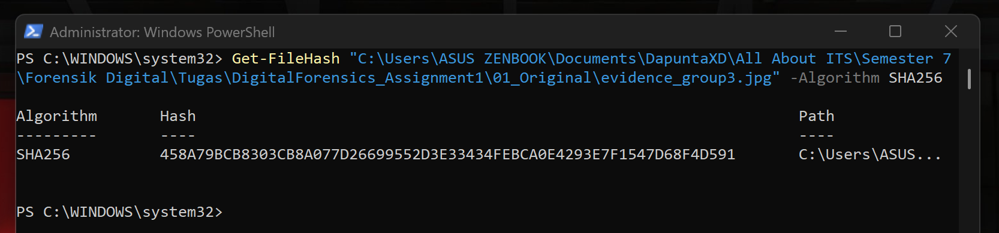

---

# 8. Copy File ke USB

Pastikan drive letter USB benar. Pada eksperimen menggunakan `E:`.

```powershell
Copy-Item "$OriginalFile" "E:\evidence_group3.jpg"
```

Target:

```text
DF_GROUP3 (E:)
└── evidence_group3.jpg
```

Screenshot:

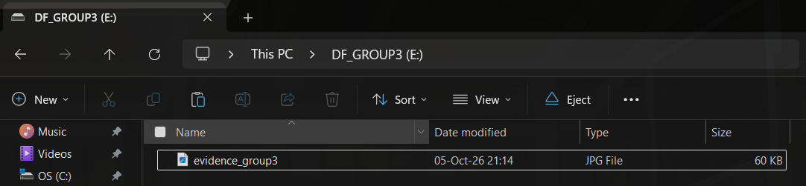

---

# 9. Hash File di USB

```powershell
Get-FileHash "E:\evidence_group3.jpg" -Algorithm SHA256
```

Target harus sama dengan original:

```text
458A79BCB8303CB8A077D26699552D3E33434FEBCA0E4293E7F1547D68F4D591
```

Screenshot:

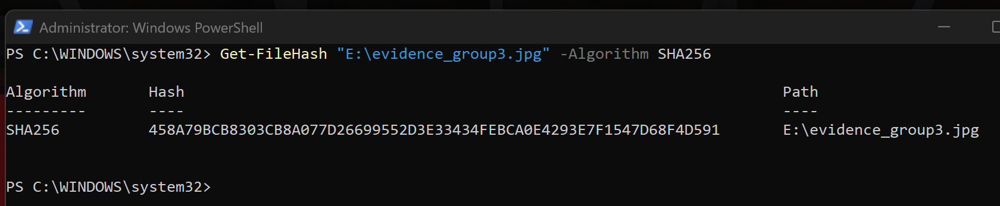

---

# 10. Validasi Original == USB

```powershell
$original = (Get-FileHash "$OriginalFile" -Algorithm SHA256).Hash
$usb = (Get-FileHash "E:\evidence_group3.jpg" -Algorithm SHA256).Hash

$original
$usb
$original -eq $usb
```

Output target:

```text
458A79BCB8303CB8A077D26699552D3E33434FEBCA0E4293E7F1547D68F4D591
458A79BCB8303CB8A077D26699552D3E33434FEBCA0E4293E7F1547D68F4D591
True
```

Screenshot:

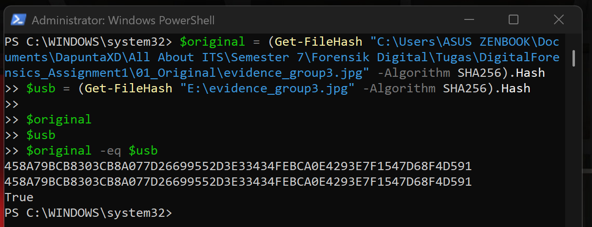

---

# 11. Verifikasi Visual

Buka:

```text
E:\evidence_group3.jpg
```

Pastikan gambar normal.

Screenshot:

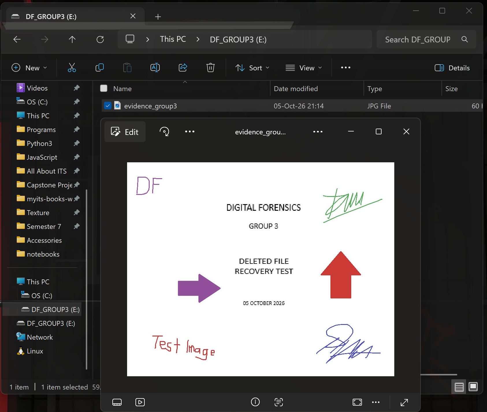

Tutup image viewer.

---

# 12. Permanent Delete

Di File Explorer:

```text
E:\
```

Pilih `evidence_group3.jpg`, lalu:

```text
Shift + Delete
```

Ketika muncul:

```text
Are you sure you want to permanently delete this file?
```

ambil screenshot:
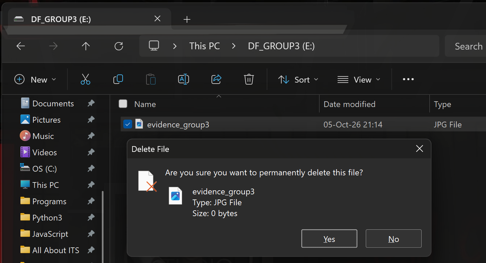

Klik:

```text
Yes
```

Pastikan Explorer menunjukkan:

```text
This folder is empty.
```

Screenshot:

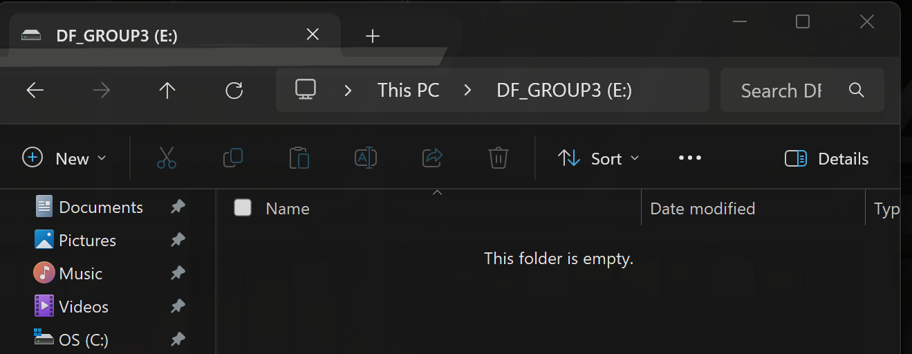

> Setelah deletion, jangan melakukan operasi tulis ke USB.

---

# 13. Jalankan FTK Imager

Jalankan:

```text
FTK Imager
→ Run as Administrator
```

Versi eksperimen:

```text
Product Version : 8.3.0.27
File Version    : 8.2.2.999
```

---

# 14. Create Disk Image

Tahap ini adalah **acquisition**, yaitu membuat salinan forensik dari USB. FTK Imager membaca media sumber dan menyimpannya sebagai forensic image agar examination tidak dilakukan langsung pada USB asli.

Menu:

```text
File
→ Create Disk Image...
```

Pada `Select Source`, pilih:

```text
Physical Drive
```

Bukan `Logical Drive`.

### Kenapa memilih Physical Drive?

**Physical Drive** berarti FTK Imager membaca perangkat USB sebagai satu media fisik secara keseluruhan.

Yang ikut diambil antara lain:

```text
partition table
filesystem
file yang masih aktif
unallocated/free space
sector yang mungkin masih berisi data deleted file
```

Sedangkan **Logical Drive** lebih berfokus pada volume atau partisi yang sudah dikenali sistem, misalnya `E:`.

Secara sederhana:

```text
Physical Drive
→ melihat seluruh USB sebagai perangkat

Logical Drive
→ melihat satu volume/partisi seperti E:
```

Untuk deleted-file recovery, `Physical Drive` dipilih agar acquisition lebih lengkap dan area yang tidak terlihat sebagai file aktif tetap ikut masuk ke forensic image.

Klik:

```text
Next
```

Screenshot:

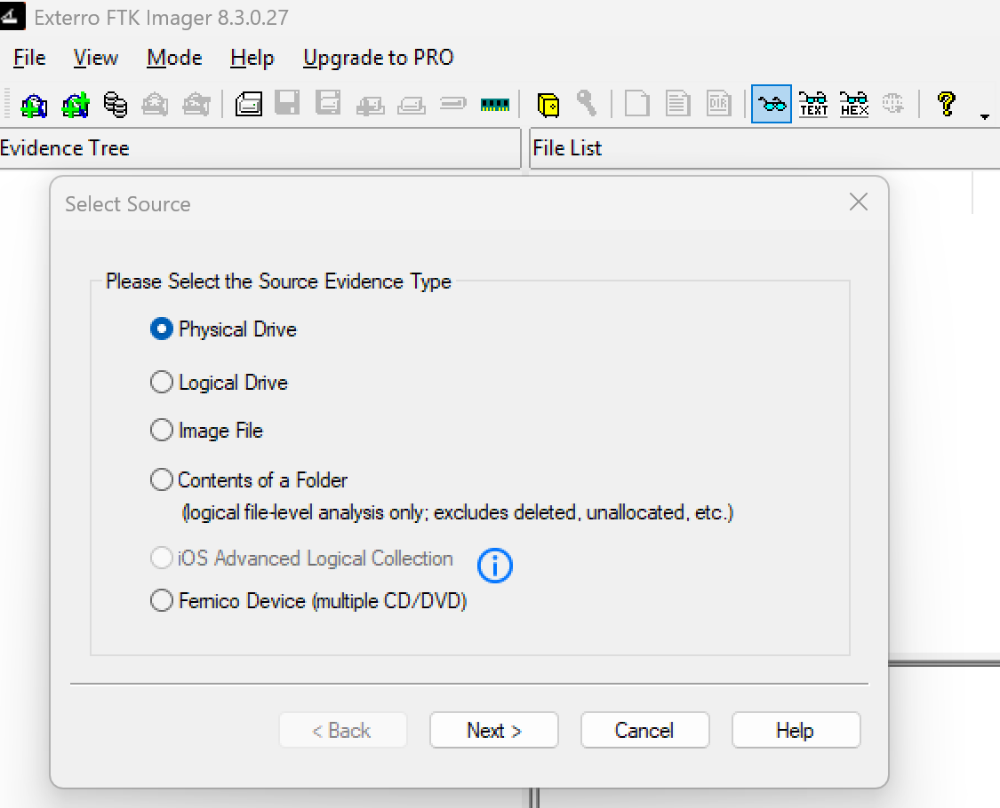

---

# 15. Pilih SanDisk Physical Drive

Pilih:

```text
\\.\PHYSICALDRIVE1 - SanDisk Cruzer Switch USB Device
```

Nomor physical drive dapat berbeda. Cocokkan model dan ukuran.

Klik:

```text
Finish
```

Screenshot:

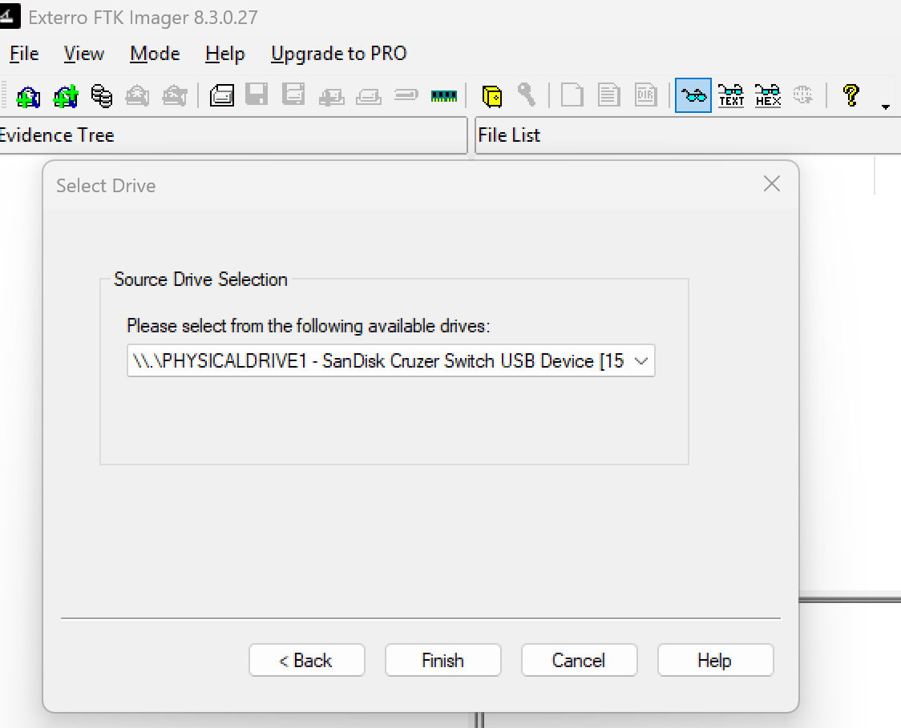

---

# 16. Pilih Image Type

Pada `Create Image`:

```text
Add...
```

Pada `Select Image Type`, pilih:

```text
Raw (dd)
```

### Kenapa memilih Raw (dd)?

**Raw (dd)** adalah format forensic image yang pada dasarnya menyimpan salinan sector-by-sector dari media sumber tanpa format container yang kompleks.

Secara sederhana:

```text
USB
sector 1
sector 2
sector 3
...
→ disalin berurutan
→ Raw image
```

Raw (dd) dipilih karena:
- sederhana,
- isinya merupakan salinan langsung sector media,
- kompatibel dengan banyak forensic tool,
- dapat langsung dibaca oleh TestDisk,
- cocok untuk eksperimen USB kecil seperti ini.

Perbandingan singkat:

| Format | Gambaran sederhana |
|---|---|
| **Raw (dd)** | Salinan sector-by-sector sederhana. Kompatibilitas sangat luas. Hash disimpan/dicatat secara terpisah. |
| **E01** | Format forensic container yang dapat menyimpan metadata, compression, dan informasi verifikasi di dalam formatnya. |
| **AFF** | Format forensic container lain dengan dukungan metadata. |
| **SMART** | Format image yang didukung FTK untuk kebutuhan tertentu, tetapi tidak diperlukan pada eksperimen ini. |

E01 bukan format yang buruk. Untuk kasus yang lebih besar, compression dan metadata E01 dapat berguna. Namun untuk eksperimen ini Raw (dd) lebih sederhana dan langsung kompatibel dengan workflow TestDisk yang digunakan.

Jangan pilih:

```text
SMART
E01
AFF
```

Klik:

```text
Next
```

Screenshot:

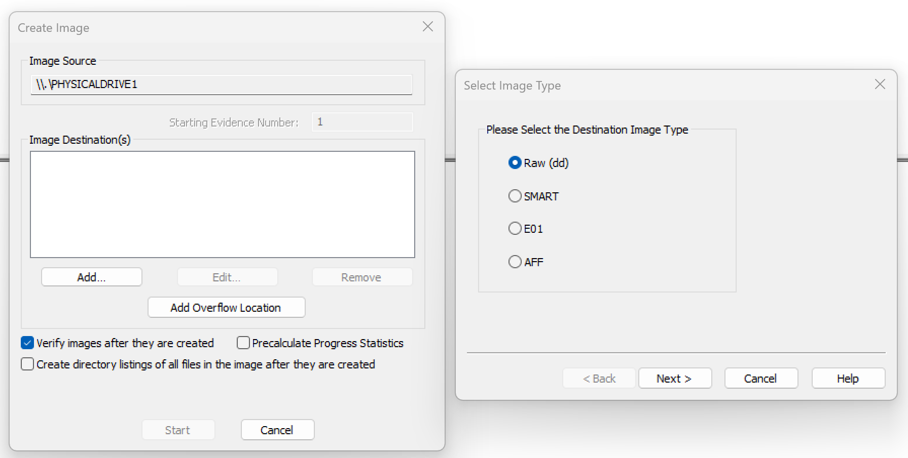

---

# 17. Isi Evidence Item Information

```text
Case Number:
DF-A1-G3-2026

Evidence Number:
E-01

Unique Description:
SanDisk Cruzer Switch 16GB - Deleted File Recovery

Examiner:
Dapunta Adyapaksi Ratyanasja / Tamam Fajar Briliansyah

Notes:
Physical acquisition of FAT32 USB flash drive after permanent deletion of evidence_group3.jpg.
```

Klik `Next`.

Screenshot:

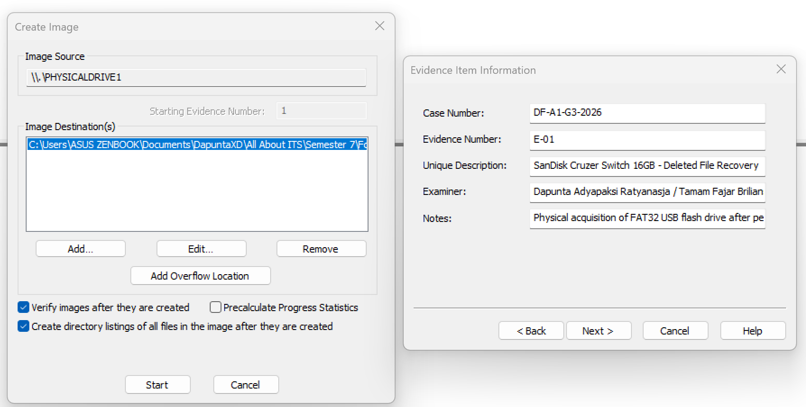

---

# 18. Destination Forensic Image

Destination:

```text
C:\Users\ASUS ZENBOOK\Documents\DapuntaXD\All About ITS\Semester 7\Forensik Digital\Tugas\DigitalForensics_Assignment1\02_Acquisition
```

Filename:

```text
Group3_SanDisk16GB_20261005
```

Output eksperimen:

```text
Group3_SanDisk16GB_20261005.001
```

Gunakan default FTK Imager untuk fragment size karena nilai spesifiknya tidak terdokumentasi pada eksperimen.

---

# 19. Acquisition Settings

Pada tahap ini FTK Imager sudah mengetahui:
- sumber evidence yang akan dibaca,
- format image yang digunakan,
- lokasi penyimpanan forensic image.

Acquisition kemudian dilakukan dengan membaca USB dan menulis hasilnya ke file image di internal storage. USB berperan sebagai **source**, sedangkan file `.001` menjadi **working forensic image** yang akan diperiksa pada tahap berikutnya.

Pastikan:

```text
[x] Verify images after they are created
[x] Create directory listings of all files in the image after they are created
[ ] Precalculate Progress Statistics
```

Source:

```text
\\.\PHYSICALDRIVE1
```

Klik:

```text
Start
```

Screenshot:

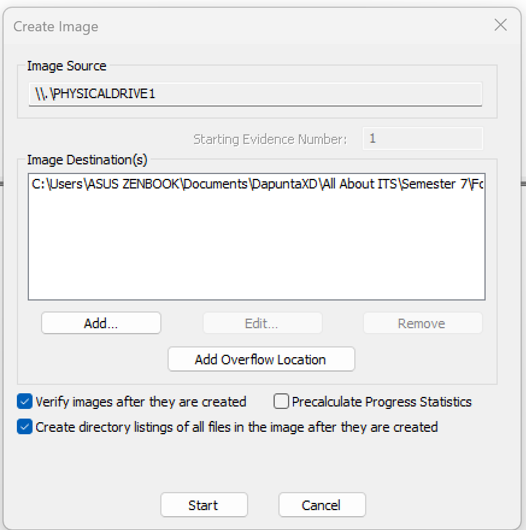

---

# 20. Tunggu Acquisition

FTK Imager menampilkan:

```text
Creating Image...
```

Jangan:
- cabut USB
- buka drive evidence
- copy file ke USB
- menjalankan recovery dari physical USB

Screenshot:

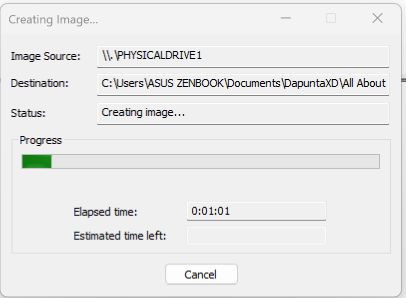

---

# 21. Verifikasi Acquisition

Setelah selesai, FTK menampilkan `Drive/Image Verify Results`.

Target eksperimen:

```text
Name:
Group3_SanDisk16GB_20261005.001

Sector count:
30751744
```

MD5:

```text
Computed hash = Report Hash
Verify result = Match
```

SHA1:

```text
Computed hash = Report Hash
Verify result = Match
```

Bad blocks:

```text
No bad blocks found in image
```

Screenshot:

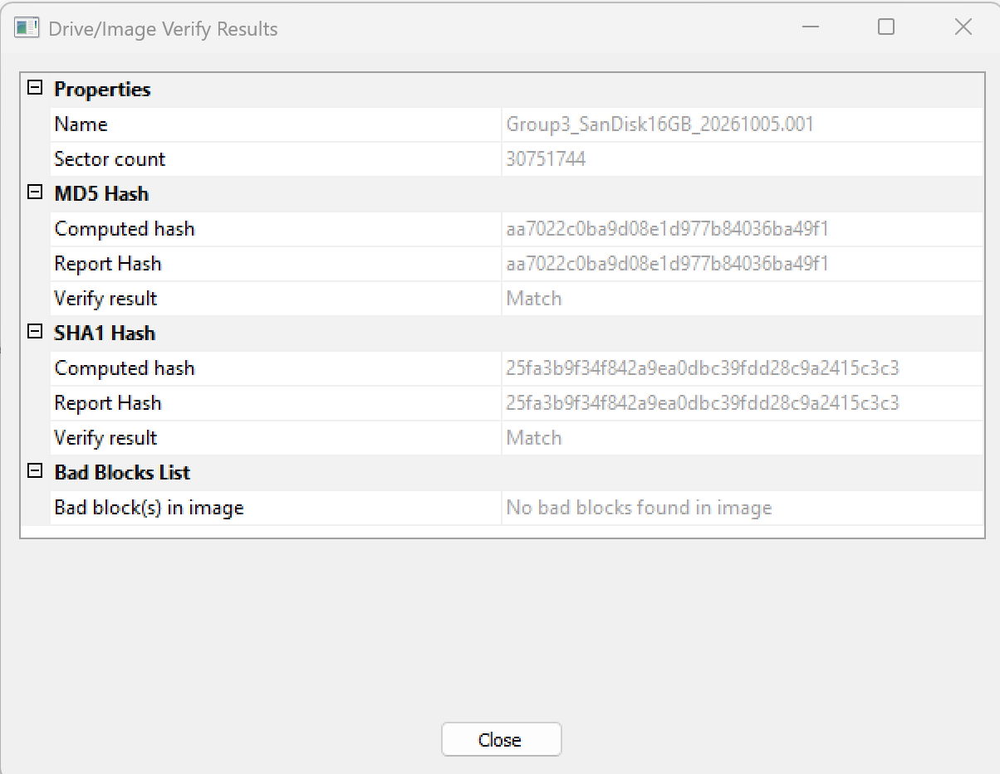

---

# 22. File Hasil Acquisition

Folder `02_Acquisition` berisi:

```text
Group3_SanDisk16GB_20261005.001
Group3_SanDisk16GB_20261005.001.csv
Group3_SanDisk16GB_20261005.001.txt
```

`.001` adalah raw forensic image utama.

Jika Windows menampilkan `.001` sebagai WinRAR archive, itu hanya file association. Jangan extract menggunakan WinRAR.

---

# 23. Definisikan Forensic Image

```powershell
$ImageFile = "$Root\02_Acquisition\Group3_SanDisk16GB_20261005.001"
```

---

# 24. Hash Forensic Image Setelah Acquisition

Tahap ini merupakan **integrity verification**. SHA-256 forensic image dicatat sebagai nilai pembanding. Setelah examination selesai, hash image dihitung kembali.

Jika nilainya tetap sama:

```text
hash acquisition == hash post-analysis
```

maka dapat ditunjukkan bahwa forensic image tidak berubah selama proses examination.

Jalankan:

```powershell
Get-FileHash "$ImageFile" -Algorithm SHA256
```

Nilai eksperimen:

```text
C2E427E0A413D0D6A43C9ED750C16FB2A9177ED9784F7D8211DCA699D8EB24A1
```

Simpan:

```powershell
(Get-FileHash "$ImageFile" -Algorithm SHA256).Hash |
    Set-Content "$HashDir\image_sha256_acquisition.txt"
```

Screenshot:

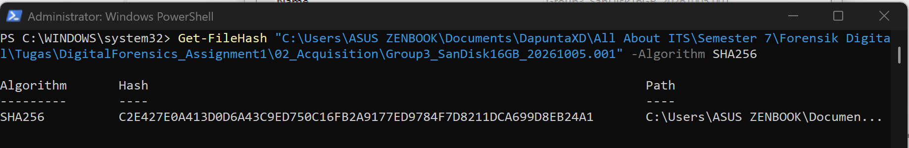

---

# 25. Preserve Physical USB

Eject `DF_GROUP3`, lalu cabut SanDisk.

Mulai tahap ini, examination hanya dilakukan terhadap:

```text
Group3_SanDisk16GB_20261005.001
```

---

# 26. Jalankan TestDisk ke Forensic Image

Mulai bagian ini masuk ke tahap **examination**.

FTK Imager sebelumnya digunakan untuk membuat dan menjaga forensic image. TestDisk sekarang digunakan untuk **membaca struktur filesystem di dalam image**, mencari entry file yang sudah dihapus, dan melakukan recovery ke folder terpisah.

Dengan demikian:

```text
FTK Imager = membuat evidence image
TestDisk   = memeriksa image dan mencari deleted file
```

TestDisk diarahkan ke forensic image `.001`, bukan ke USB fisik.

Path TestDisk eksperimen:

```text
C:\App & Program\testdisk-7.2.win\testdisk-7.2
```

Jalankan:

```powershell
& "C:\App & Program\testdisk-7.2.win\testdisk-7.2\testdisk_win.exe" "$ImageFile"
```

Jika `$ImageFile` belum ada di session:

```powershell
$ImageFile = "C:\Users\ASUS ZENBOOK\Documents\DapuntaXD\All About ITS\Semester 7\Forensik Digital\Tugas\DigitalForensics_Assignment1\02_Acquisition\Group3_SanDisk16GB_20261005.001"

& "C:\App & Program\testdisk-7.2.win\testdisk-7.2\testdisk_win.exe" "$ImageFile"
```

---

# 27. TestDisk Logging

Jika tampil:

```text
[ Create ]
[ Append ]
[ No Log ]
```

pilih:

```text
[ Create ]
```

Tekan `Enter`.

---

# 28. Pilih Media

Pastikan yang tampil adalah path forensic image, bukan physical drive.

Pilih:

```text
[Proceed]
```

Tekan `Enter`.

---

# 29. Partition Table Type

Karena USB dibuat dengan MBR, pilih:

```text
[Intel]
Intel/PC partition
```

Tekan `Enter`.

---

# 30. Advanced Filesystem Utilities

Pilih:

```text
[Advanced]
```

Tekan `Enter`.

Jangan gunakan opsi write/repair.

---

# 31. Pastikan FAT32 Terdeteksi

Target:

```text
1 P FAT32 LBA
...
[DF_GROUP3]
```

Eksperimen:

```text
Size in sectors: 30748672
Label          : DF_GROUP3
```

Screenshot:

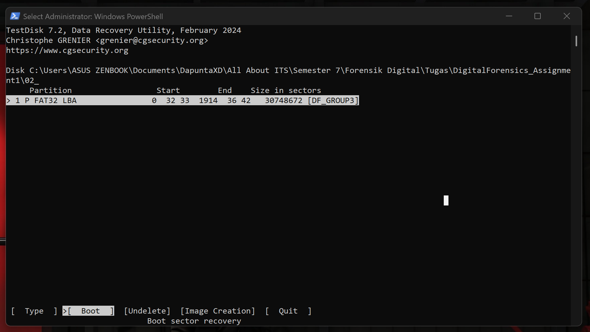

---

# 32. Undelete

Pilih:

```text
[Undelete]
```

Tekan `Enter`.

File deleted yang ditemukan:

```text
evidence_group3.jpg
Size: 61320 bytes
Date: 5-Oct-2026 21:14
```

Screenshot:

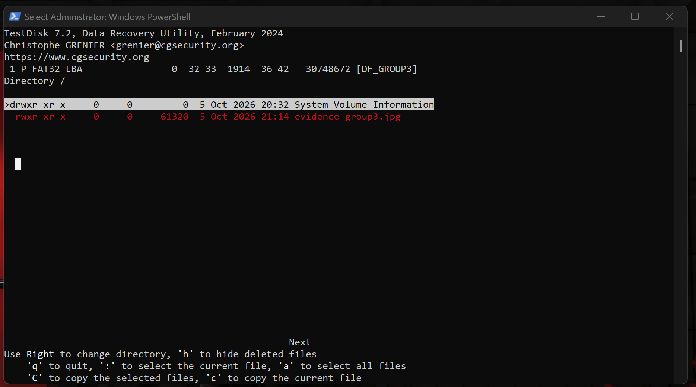

---

# 33. Copy Deleted File

Sorot:

```text
evidence_group3.jpg
```

Tekan:

```text
c
```

huruf kecil, untuk `copy current file`.

---

# 34. Pilih Destination

Target:

```text
C:\Users\ASUS ZENBOOK\Documents\DapuntaXD\All About ITS\Semester 7\Forensik Digital\Tugas\DigitalForensics_Assignment1\03_Recovery
```

Jika TestDisk mulai dari:

```text
C:\WINDOWS\system32
```

gunakan entry:

```text
..
```

untuk naik folder.

Urutan:

```text
C:\Windows\System32
→ C:\Windows
→ C:\
→ Users
→ ASUS ZENBOOK
→ Documents
→ DapuntaXD
→ All About ITS
→ Semester 7
→ Forensik Digital
→ Tugas
→ DigitalForensics_Assignment1
→ 03_Recovery
```

Navigasi:

```text
↑ / ↓     memilih
Enter / → masuk folder
..        parent directory
Home      lompat ke atas daftar
Page Up   naik daftar
```

---

# 35. Konfirmasi Destination

Jika path sudah tepat di `03_Recovery`, tekan:

```text
C
```

huruf besar.

Perbedaan:

```text
c kecil → mulai copy current file
C besar → konfirmasi destination
```

---

# 36. Pastikan Recovery Berhasil

Target output:

```text
Copy done! 1 ok, 0 failed
```

Screenshot:

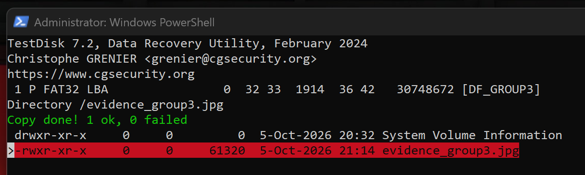

Hasil:

```text
03_Recovery
└── evidence_group3.jpg
```

---

# 37. Keluar TestDisk

Tekan:

```text
q
```

berulang kali sampai kembali ke PowerShell.

Ini penting karena TestDisk dapat mengunci forensic image.

---

# 38. Hash Recovered File

Bagian ini masuk ke tahap **analysis**. File sudah berhasil direcover pada tahap examination, tetapi keberhasilan tersebut masih perlu diverifikasi.

SHA-256 file recovered dibandingkan dengan SHA-256 file original. Jika nilainya identik, berarti isi file recovered sama persis dengan original, bukan hanya terlihat mirip ketika dibuka.

Jika session baru:

```powershell
$Root = "C:\Users\ASUS ZENBOOK\Documents\DapuntaXD\All About ITS\Semester 7\Forensik Digital\Tugas\DigitalForensics_Assignment1"
$OriginalFile = "$Root\01_Original\evidence_group3.jpg"
$RecoveredFile = "$Root\03_Recovery\evidence_group3.jpg"
```

Hash:

```powershell
Get-FileHash "$RecoveredFile" -Algorithm SHA256
```

---

# 39. Compare Original vs Recovered

```powershell
$original = (Get-FileHash "$OriginalFile" -Algorithm SHA256).Hash
$recovered = (Get-FileHash "$RecoveredFile" -Algorithm SHA256).Hash

$original
$recovered
$original -eq $recovered
```

Target:

```text
458A79BCB8303CB8A077D26699552D3E33434FEBCA0E4293E7F1547D68F4D591
458A79BCB8303CB8A077D26699552D3E33434FEBCA0E4293E7F1547D68F4D591
True
```

Screenshot:

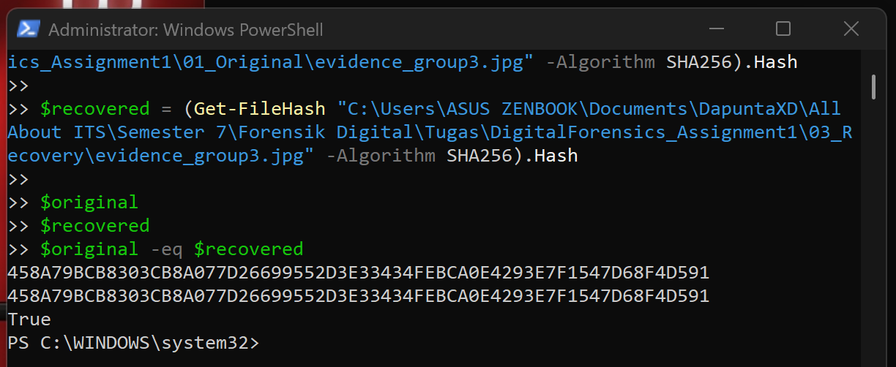

---

# 40. Simpan Hash Recovered

```powershell
Get-FileHash "$RecoveredFile" -Algorithm SHA256 |
    Format-List |
    Out-File "$Root\05_Hash\recovered_sha256.txt"
```

---

# 41. Verifikasi Forensic Image Setelah Analysis

```powershell
$ImageFile = "$Root\02_Acquisition\Group3_SanDisk16GB_20261005.001"

$imageAfter = (Get-FileHash "$ImageFile" -Algorithm SHA256).Hash
$imageBefore = (Get-Content "$Root\05_Hash\image_sha256_acquisition.txt").Trim()

$imageBefore
$imageAfter
$imageBefore -eq $imageAfter
```

Target:

```text
True
```

Nilai eksperimen:

```text
C2E427E0A413D0D6A43C9ED750C16FB2A9177ED9784F7D8211DCA699D8EB24A1
```

Simpan:

```powershell
$imageAfter |
    Set-Content "$Root\05_Hash\image_sha256_post_analysis.txt"
```

Screenshot:

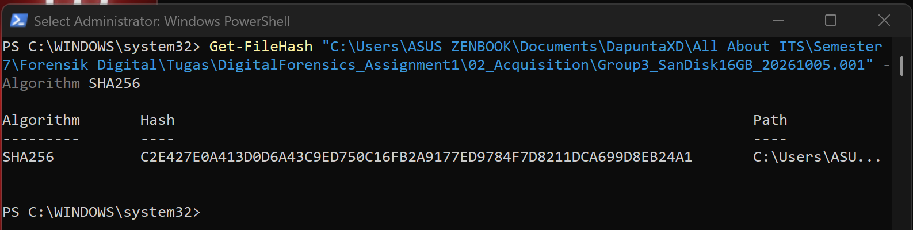

---

# 42. Jika File Sedang Dipakai Proses Lain

Jika:

```text
The process cannot access the file ...
because it is being used by another process.
```

Tutup TestDisk dengan `q` berulang kali. Jika perlu, tutup FTK Imager juga.

Lalu:

```powershell
Get-FileHash "$ImageFile" -Algorithm SHA256
```

---

# 43. Verifikasi Visual Recovered File

Buka:

```text
03_Recovery\evidence_group3.jpg
```

Pastikan isi gambar utuh.

Screenshot:

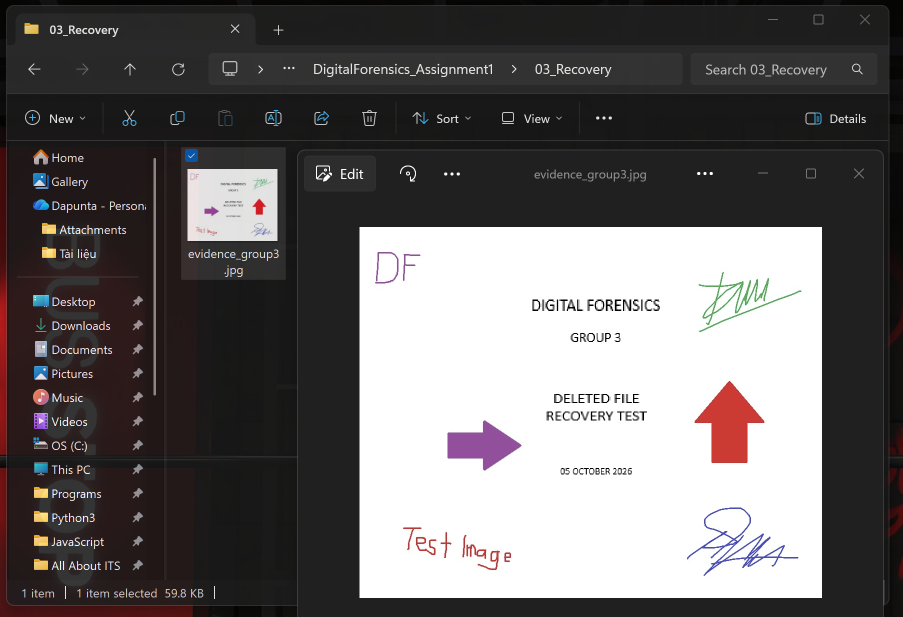

---

# 44. Checklist Hasil Akhir

Setelah examination dan analysis selesai, hasil masuk ke tahap **reporting**. Semua langkah penting, screenshot, hash, identitas evidence, hasil recovery, serta keterbatasan dicatat agar prosedur dapat diperiksa dan direproduksi.

Dalam laporan forensik, informasi utama yang perlu dipertahankan antara lain:
- **Evidence Inventory**: apa saja evidence yang digunakan dan identitasnya.
- **Integrity Verification**: hash evidence/image dan hasil perbandingannya.
- **Chain of Custody**: siapa yang menangani evidence, kapan, untuk tujuan apa, dan lokasi penyimpanannya.
- **Forensic Process**: Preparation, Collection, Examination, Analysis, dan Reporting.
- **Findings**: hasil penting yang ditemukan.
- **Conclusion**: jawaban akhir terhadap tujuan pemeriksaan.

```text
USB physical evidence
    ↓
permanently deleted file

FTK Imager
    ↓
Group3_SanDisk16GB_20261005.001

FTK Verification
    ↓
MD5  : Match
SHA1 : Match
Bad blocks : None

SHA-256 forensic image
    ↓
recorded before examination

TestDisk
    ↓
FAT32 DF_GROUP3 identified
    ↓
deleted evidence_group3.jpg found
    ↓
Copy done! 1 ok, 0 failed

Recovered file
    ↓
SHA256(original) == SHA256(recovered)
    ↓
True

Forensic image
    ↓
SHA256(before examination) == SHA256(after examination)
    ↓
True
```

---

# 45. Nilai Hash Eksperimen Group 3

## Original JPEG

```text
458A79BCB8303CB8A077D26699552D3E33434FEBCA0E4293E7F1547D68F4D591
```

## USB JPEG sebelum deletion

```text
458A79BCB8303CB8A077D26699552D3E33434FEBCA0E4293E7F1547D68F4D591
```

## Recovered JPEG

```text
458A79BCB8303CB8A077D26699552D3E33434FEBCA0E4293E7F1547D68F4D591
```

```text
Original == USB == Recovered
```

## Forensic Image sebelum examination

```text
C2E427E0A413D0D6A43C9ED750C16FB2A9177ED9784F7D8211DCA699D8EB24A1
```

## Forensic Image setelah examination

```text
C2E427E0A413D0D6A43C9ED750C16FB2A9177ED9784F7D8211DCA699D8EB24A1
```

```text
Image Before == Image After
```

---

# 46. Urutan Screenshot

```text
01_pembersihan.png
02_formatting.png
03_properties_disk.png
04_versi_ftk_imager.png
05_versi_testdisk.png
07_original_sha256.png
08_file_added_to_usb.png
09_usb_sha256.png
10_validasi_kesamaan.png
11_usb_file_opened.png
12_shift_delete_confirmation.png
13_file_deleted_from_usb.png
14_ftk_select_source_physical_drive.png
15_ftk_select_sandisk_physical_drive.png
16_ftk_image_type_raw_dd.png
17_ftk_evidence_information.png
18_ftk_acquisition_settings.png
19_ftk_acquisition_progress.png
20_ftk_verification_result.png
21_image_sha256_acquisition.png
22_testdisk_fat32_partition.png
23_testdisk_deleted_file_found.png
24_testdisk_recovery_success.png
25_recovered_sha256.png
26_image_sha256_post_analysis.png
27_recovered_file_opened.png
```

---

# 47. Ringkasan Command Copy-Paste

## Variabel PowerShell

```powershell
$Root = "C:\Users\ASUS ZENBOOK\Documents\DapuntaXD\All About ITS\Semester 7\Forensik Digital\Tugas\DigitalForensics_Assignment1"
$OriginalFile = "$Root\01_Original\evidence_group3.jpg"
$RecoveredFile = "$Root\03_Recovery\evidence_group3.jpg"
$ImageFile = "$Root\02_Acquisition\Group3_SanDisk16GB_20261005.001"
$HashDir = "$Root\05_Hash"
```

## Buat Folder

```powershell
New-Item -ItemType Directory -Force "$Root\01_Original"
New-Item -ItemType Directory -Force "$Root\02_Acquisition"
New-Item -ItemType Directory -Force "$Root\03_Recovery"
New-Item -ItemType Directory -Force "$Root\04_Screenshots"
New-Item -ItemType Directory -Force "$Root\05_Hash"
```

## DiskPart

```text
diskpart
list disk
select disk 1
detail disk
clean all
convert mbr
create partition primary
format fs=fat32 quick label=DF_GROUP3
assign
detail disk
list volume
exit
```

> Jangan copy-paste `select disk 1` tanpa verifikasi. Sesuaikan nomor disk berdasarkan `list disk` dan `detail disk`.

## Hash Original

```powershell
Get-FileHash "$OriginalFile" -Algorithm SHA256
```

## Copy ke USB

```powershell
Copy-Item "$OriginalFile" "E:\evidence_group3.jpg"
```

## Hash USB

```powershell
Get-FileHash "E:\evidence_group3.jpg" -Algorithm SHA256
```

## Compare Original dan USB

```powershell
$original = (Get-FileHash "$OriginalFile" -Algorithm SHA256).Hash
$usb = (Get-FileHash "E:\evidence_group3.jpg" -Algorithm SHA256).Hash
$original
$usb
$original -eq $usb
```

## Hash Forensic Image

```powershell
(Get-FileHash "$ImageFile" -Algorithm SHA256).Hash |
    Set-Content "$HashDir\image_sha256_acquisition.txt"
```

## Jalankan TestDisk

```powershell
& "C:\App & Program\testdisk-7.2.win\testdisk-7.2\testdisk_win.exe" "$ImageFile"
```

## Compare Original dan Recovered

```powershell
$original = (Get-FileHash "$OriginalFile" -Algorithm SHA256).Hash
$recovered = (Get-FileHash "$RecoveredFile" -Algorithm SHA256).Hash
$original
$recovered
$original -eq $recovered
```

## Compare Image Before dan After

```powershell
$imageBefore = (Get-Content "$HashDir\image_sha256_acquisition.txt").Trim()
$imageAfter = (Get-FileHash "$ImageFile" -Algorithm SHA256).Hash
$imageBefore
$imageAfter
$imageBefore -eq $imageAfter
```

## Simpan Hash Post-analysis

```powershell
$imageAfter |
    Set-Content "$HashDir\image_sha256_post_analysis.txt"
```
